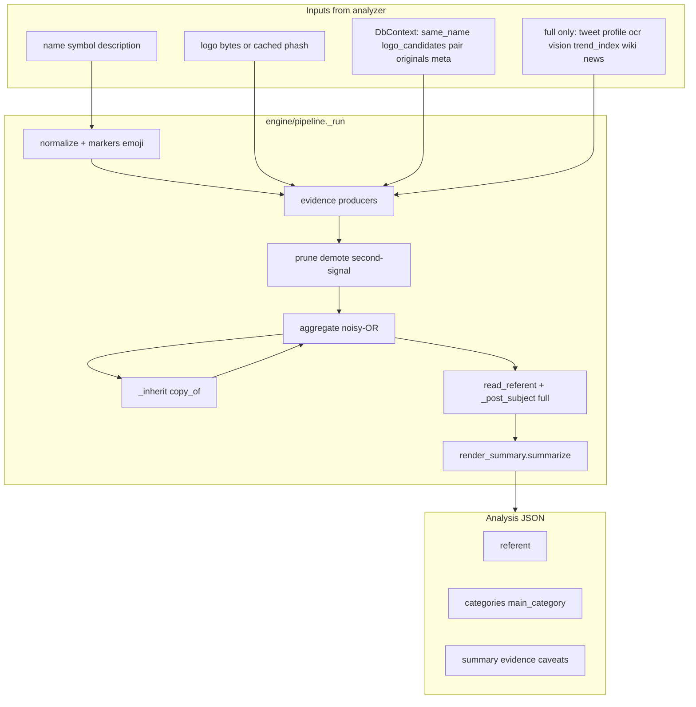

# Narrative determination audit

Audit date: 2026-10-20. Scope: how TokenSage decides **what a pump.fun token is about**—referent (topic/subject), categories (narrative type), image meaning, X linkage, trends, summary text, and confidence—and what **TrenchScanner** gets at `depth=basic` vs `depth=full`. Code paths only; no load test or precision re-measurement in this pass.

## Executive summary (TrenchScanner)

| Need | Primary API fields | Best depth | Notes |
|------|-------------------|------------|--------|
| “What is this coin about?” | `referent`, `main_category`, `summary` | **basic** for speed; **full** when X/trends disambiguate | Basic already runs the full text+hash engine; it skips X fetch, trends, OCR run, vision, Wikipedia search |
| “Is the name a real entity or just ‘a frog coin’?” | `referent.generic`, `referent.confidence`, `referent.supported_by` | basic | Generic referents (`generic: true`) do not get `referent.wave` counts |
| “What does the picture mean?” | `image.phash`, `copy_of[]` / `image.near_duplicates`, `evidence` (`image_hash`, `ocr_*`, `vision`) | basic for **copy**; full for **OCR/CLIP** | Production defaults: **OCR off**, **CLIP off**—logo *semantics* are mostly hash-based + text |
| “Is the X link the story?” | `x.text`, `x.relation`, `referent.post_id`, summary narrative clause | **full** | `_post_subject` and `_narrative` run only at full depth with fetched tweet |
| “Is it riding news/trends?” | `trend`, category `news_event`, evidence `kind: trend` | **full** | `POST /v1/tokens:now` refreshes trend block on stored full reads |
| “Copy vs reference?” | `copy_of[]`, `lineage`, flags `copycat` / `references_known_coin` | basic | Uses DB logo candidates + same-name search + known coins |

**Takeaway:** TrenchScanner’s high-volume `depth=basic` path is **not** “name-only”—it is a full deterministic pipeline on name, symbol, description, logo hashes, pair token context, lineage, and meta signals. What basic **cannot** see is the **linked post text**, **live trend index**, **Wikipedia disambiguation pages**, **fresh OCR**, and **optional vision/embed** layers. For launch-time decisions that depend on “what the tweet said” or “what’s trending now,” **full** (or a cached full read + `:now` trend refresh) is required.

---

## End-to-end flow

**Single entry:** `run_basic` / `run_full` → `_run(inp, depth)` in `tokensage/engine/pipeline.py`.  
**Persistence:** `analyzer.build_document()` maps `EngineOutput` → `Analysis` (`referent_read` → `referent`, `agg` → categories, `out.summary`, `out.evidence`).

---

## Layer 1 — Normalization and ticker

| Step | Module | Narrative role |
|------|--------|----------------|
| Fee stripping | `strip_fee_text` + `data/referent_rules.yaml` | Creator-fee sentences removed from description/X before lexicon reads them |
| Markers | `normalize` + templates | Derivative/version/rival markers → `derivative/*` evidence before entity match |
| Emoji | CLDR keywords → WordNet-ish classes | Weak category hints (`emoji` evidence), not referents |
| Ticker | `ticker.explain` | Human-readable vowel-drop / acronym explanation in `ticker_explanation` and summary |
| Symbol-is-name | `_symbol_is_name` | Ticker spelling the compact name counts as **one** input channel in aggregation |

---

## Layer 2 — Text meaning (lexicon, gazetteer, known coins)

| Source | Module | Referent | Categories |
|--------|--------|----------|------------|
| Entities (people, coins, memes, events) | `lexicon` + `gazetteer` + `data/entities*.yaml` | `ReferentCandidate` on `entity` / `referent` rows | Entity’s taxonomy labels |
| Slang / templates | `knowledge` families | Template families (`template_family`) | `meme_template`, `crypto_native/*`, etc. |
| Famous coins | `known_coins` | Copy/reference referents from seed table | Coin’s stored categories; `derivative/reference` vs copycat |
| Compounds | `compound_parts` + `_compound_evidence` | Same as lexicon, slightly lower weight | Mascot compounds (“dogwifhat”) |
| Domains | `_domain_evidence` | Rare | `crypto_native` hints from website field |
| Wikipedia (full) | `wikilookup` | Search hits; homonym demotion in `_demote_wiki_homonyms` | `news_event`, entity kinds |
| Platform noise | `_platform_referents` | Solana/pump.fun labels demoted outside name | `platform_text_factor` in rules YAML |
| Mentions | `_demote_mentions` | Post/description-only entities without name echo | — |
| Second signal | `_require_second_signal` | One everyday word alone weakened | Stops “GAME” → celebrity without corroboration |

**Precision policy** is largely in `data/referent_rules.yaml` (mention-only factor, wiki reject lists, x_subject thresholds) and in `tests/test_category_precision.py` (TrenchScanner brief 2026-10-07).

---

## Layer 3 — Image (“picture meaning”)

TokenSage does **not** run cloud vision. Picture signal splits into four paths:

### 3a. Perceptual hash (basic + full)

- **Module:** `engine/image.py` — decode, phash/dhash, palette, animation; `analyzer` supplies `DbContext.image_candidates` from DB.
- **Evidence:** `_image_evidence` → `kind: image_hash`, label `derivative/logo_reuse`, optional **referent** when candidate is a **known coin** (`logo:SYMBOL`).
- **Consumer fields:** `image.phash`, `image.near_duplicates`, `copy_of[].match` / `image_distance`, flags `copycat`, `references_known_coin`.
- **Meaning:** “same or edited logo as X” — strong for **copycat** narrative, weak for **subject** unless X is a known coin with a referent.

### 3b. OCR (full only; default **off** in production)

- **Module:** `engine/ocr.py`; analyzer runs OCR in `_full_depth` when `ENABLE_OCR=true`, else uses cache only.
- **Evidence:** Logo text as extra lexicon pass on `where: image`; `ocr_other_ticker` when OCR shows a **different** famous ticker.
- **Config note:** `config.py` documents OCR disabled since 2026-10-16 (no TrenchScanner AUC gain; queue contention).

### 3c. Vision / CLIP (full only; default **off**)

- **Module:** `engine/vision.py` — local SigLIP ONNX + `data/vision_head.npz`.
- **Evidence:** `kind: vision` → taxonomy label, **gated** by `vision.gate()` (only if name/desc/X agree or no theme yet); **never names a referent** (`MAX_WEIGHT` 0.4).
- **Consumer:** `image.labels[]` (top 3 visual classes).

### 3d. X media match (full only)

- **Module:** `engine/xmatch.py` — hash post/profile images vs logo.
- **Consumer:** `x.match.image`, flag `x_image_match`; separate from blended narrative evidence.

**Practical guidance for TrenchScanner:** treat **logo subject** as coming from **text + known-coin hash match**, not from `image.labels` unless `ENABLE_CLIP` is on. Use **near-duplicate distance** for copy narrative, not for “this is a squirrel.”

---

## Layer 4 — Context that steers topic

| Signal | Module | Effect |
|--------|--------|--------|
| Pair / quote mint | `pairing` | Non-SOL pair: weak categories; `builds_on` → strong referent from pair token’s analysis |
| Same-name / external search | `_same_name_evidence` | Copycat vs sibling rank; can add referent from namesake |
| Lineage | `lineage` + `_inherit` | Copy inherits original’s categories/referent at `inherit_factor` (~0.8), `supported_by: ["copy_of"]` |
| Launch meta | `meta` | Spiking name words → `launch_meta` evidence; weak `"current pump.fun meta: <word>"` referent when nothing else |
| DB pair token | `channel: db` | Categories from pair; excluded from `own_categories` unless `derivative/pair_family` |

---

## Layer 5 — X narrative (full depth only)

When `depth == "full"` and tweet/profile fetched:

1. **`xsignals.assess`** — relation (`narrative_reference`, `launch_announcement`, …), flags, evidence from post/profile/quoted/replied text and account-size hints (weak, never sole theme).
2. **Extra lexicon passes** on `where: x` for post and quoted/replied text.
3. **`_post_subject`** (`engine/xsubject.py`) — if post names subject and beats weak/name-only reads, sets `referent` with `source: "x"`, `post_id`, `supported_by: ["x"]`; may replace `agg.referent`.
4. **`_narrative`** — summary sentence: “launched N after @user posted: …” for borrowed narratives.
5. **`xmatch`** — **parallel** read: post-alone vs token-alone (`x.match.referent`, `fit`, `verdict`); does not replace blended aggregation but flags `x_content_mismatch`.

**Basic depth:** `x` block may exist from metadata URL parsing, but **no** `x.text`, **no** subject extraction, **no** `x.match`, **no** post-driven referent.

---

## Layer 6 — Trends and news (full depth only)

- **Index:** Wikipedia pageview spikes, Google Trends, X trends list (`fulldepth.trend_index`).
- **Collect:** `trends.collect` matches index + `news_hits` / Bluesky against name, description, X texts, OCR text, existing referent labels.
- **Evidence:** `kind: trend` → can lift `news_event`, confirm dated lexicon events (`_news_needs_a_date`), and add **trend** to `supported_by` in `read_referent` via `_trend_backs`.
- **Stored for refresh:** `trend_referents` on engine output → analyzer `TREND_INPUTS_KEY` for `POST /v1/tokens:now`.

**Basic depth:** no `trend` block; news_event from lexicon alone is suppressed without trend or launch-date window.

---

## Layer 7 — Aggregation and reported referent

### Categories (`engine/aggregate.py`)

- Per-label **noisy-OR** across channels: `name`, `symbol`, `description`, `image`, `x`, `trend`, `db`, `copy_of`.
- Dictionary-only labels capped (`wordnet_only_cap`, `food_dictionary_cap`); description nouns need name/ticker/image backing for `food_object_abstract`.
- **`main_category`:** strongest **theme** top-level label; `derivative` and `regional_language` only win if no theme (`THEME_ORDER` tie-break).

### Referent candidate pool

- Noisy-OR over `referent` / `entity` / `image_hash` / `template_family` rows (not `known_coin` duplicate inflation).
- One vote per `(source, referent label)`.

### `read_referent` (`pipeline.py`)

Maps aggregation → API semantics:

| Situation | `referent` | `confidence` band |
|-----------|------------|-----------------|
| Named entity, strong score | `label` = entity | 0.5–0.69 one channel; 0.7+ multi-channel (lift from raw ≥ 0.45) |
| Named but &lt; 0.45 and no theme | `null` | Summary may still show weak guess text |
| Ambiguous top two | caveats | `referent is ambiguous: …` |
| Theme only | `generic: true`, label e.g. “frog” | 0.3–0.49, `source: category:…` |
| X subject wins (full) | specific phrase, `post_id` | `matched_confidence` / `lead_confidence` from rules YAML |

**Waves:** `analyzer.wave_key(label, post_id)` — post-subject referents count launches per **post id**, not normalized label (`token_read.referent_key`).

### Summary (`engine/render_summary.py`)

Template-only (no LLM): referent sentence, category phrase, subcategories, context (pair/copy/trend), ticker line, top evidence bullets, merged caveats. **`_framing`** handles modifier-head names (“cat coin tied to Elon Musk”).

---

## Basic vs full — narrative gap matrix

| Capability | basic | full |
|------------|-------|------|
| Lexicon / gazetteer / known coins on name, symbol, description | yes | yes (+ wiki search evidence) |
| Logo phash + near-dup DB | yes | yes |
| Pair token + lineage inherit | yes | yes |
| Meta / copy_of / flags | yes | yes |
| X post text in evidence | no | yes |
| X subject referent (`post_id`) | no | yes |
| Trends / news / Bluesky | no | yes |
| Run OCR on logo | no* | yes* (*off by default; cache used) |
| Vision labels | no | yes* (*off unless `ENABLE_CLIP`) |
| Embed guesses | if `ENABLE_EMBED` | if `ENABLE_EMBED` |
| `x.match` / credibility / engagement | no | yes |
| `analysis.trend` / `timed_out[]` | no | yes |

---

## Optional layers (flags)

| Flag | Default | Narrative effect |
|------|---------|------------------|
| `ENABLE_OCR` | false | Logo text → image channel lexicon |
| `ENABLE_CLIP` | false | Gated visual category guesses |
| `ENABLE_EMBED` | false | Extra category guesses from MiniLM on name/desc/X |

---

## Data quality and isolation (narrative impact)

| Topic | Risk | Mitigation (see CODE_REVIEW / SG-003) |
|-------|------|--------------------------------------|
| Caller hints | Analysis from hints before on-chain visibility | `cacheable: false`, no `x_ref`/`token_read` from hint-only mints |
| Full-depth deadline | Partial read missing X or trends | `status: partial`, `timed_out[]`, caveats; TrenchScanner ~11 min stop |
| Condensed analyses (`analysis_condense_days`) | Evidence stripped after 7d | Referent/categories retained; basic loses x/image/trend blocks |
| Shared X URL reuse | `x_credibility` ÷ reuse rank | Narrative heat not inflated by recycled links |
| Homoglyphs / spoofed handles | flags + relation `spoofed` | Credibility cut; no longer high-severity-only flag |

---

## Recommendations for TrenchScanner

1. **Default picker fields:** `referent` (with `generic`, `supported_by`, `post_id`), `main_category`, `summary`, `copy_of`, `flags`, and `evidence` (top N by weight). Use `categories[]` when multi-label UI matters.
2. **Depth strategy:** Use **basic** for bulk scan; enqueue **full** (or batch prefetch) for coins where `referent` is null/generic, `supported_by` is only `name`/`symbol`, or metadata links X. Align with quota: fall back to cached full reads when `429 quota_exceeded`.
3. **Picture:** Use `image.phash` + `copy_of` / `near_duplicates` for copy detection; do not infer animal/species from image unless `image.labels` is populated in your deployment.
4. **Waves / heat:** Only non-generic referents and post-id referents populate `referent.wave`; use `POST /v1/tokens:now` for trend refresh without re-running entire full depth (per `docs/API.md`).
5. **Trust boundaries:** Down-rank or ignore reads with `caveats` containing `hints:`, `partial:`, `referent is ambiguous`, or `very little evidence`.
6. **Calibration:** `x.match.fit` and `x.credibility` are documented as uncalibrated; prefer discrete flags and `verdict` over raw floats for gating.

---

## Primary code map

| Concern | Location |
|---------|----------|
| Pipeline orchestration | `tokensage/engine/pipeline.py` (`_run`, `read_referent`, `_post_subject`, `_inherit`) |
| Scoring | `tokensage/engine/aggregate.py` |
| Summary | `tokensage/engine/render_summary.py` |
| X subject phrase | `tokensage/engine/xsubject.py` |
| X relation + text evidence | `tokensage/engine/xsignals.py` |
| Post vs token fit | `tokensage/engine/xmatch.py` |
| Trends | `tokensage/engine/trends.py` |
| Logo hash | `tokensage/engine/image.py` |
| Vision | `tokensage/engine/vision.py` |
| Rules data | `data/referent_rules.yaml`, `data/taxonomy.yaml`, knowledge YAML |
| API mapping | `tokensage/analyzer.py` (`build_document`, `_full_depth`) |
| Contract | `docs/API.md` § referent, image, trend, x.match |

---

## Suggested follow-ups (not implemented here)

- Measure referent null-rate and generic-rate on a TrenchScanner sample at basic vs full.
- Document deployment flag matrix (OCR/CLIP/embed) in runbook next to TrenchScanner integration.
- If basic depth must infer post subject without full fetch, that would be a **product change** (contradicts v1 “X only at full”); not recommended without new signals (e.g. cached tweet text from corpus).
