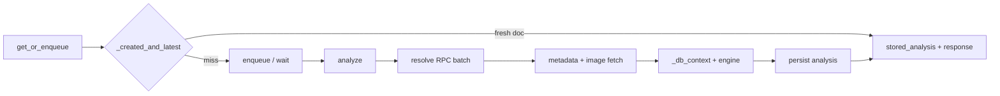

# Read-path efficiency audit

Audit date: 2026-10-20. Scope: latency and throughput for `GET/POST /v1/tokens/{ca}` (basic and full), cache hits, cold analysis, and queue wait. No load test was run in this pass; recommendations are from code review and existing test coverage.

## Executive summary

Reads already do several things well: **cache hits** use one indexed SQL round trip (`_created_and_latest`), **on-chain resolve** batches accounts and parallelizes metadata/curve/fee/frontend work, **IPFS** races gateways, **full depth** runs independent sources under a deadline, and **known coins / gazetteer** are process-cached.

The remaining cost on a **cold basic read** is mostly: (1) many **sequential Postgres round trips** in `_db_context_queries`, (2) **logo hashing on the CPU pool** while the DB waits (now overlapped — see below), (3) **optional external name searches** (pump.fun + DexScreener), and (4) **metadata/IPFS + RPC** when nothing is cached. **Full reads** are dominated by the **full-depth deadline** (default 20s) and X/media/trends fetches, not by the basic engine.

Tuning and small code changes can shave tens to hundreds of milliseconds off warm paths; cold basic reads are often **1–5+ seconds** depending on IPFS and RPC.

---

## Read lifecycle (hot path)

| Stage | Typical cost driver | Parallelism today |
|--------|---------------------|-------------------|
| Cache hit | JSON validate (`stored_analysis`), one SQL | N/A (already minimal) |
| Enqueue / wait | Pool acquire ×2–3, `DoneWaiter` | Job reuse within 30s |
| Resolve | 1× `getMultipleAccounts` + parallel meta/curve/fee | Good |
| Metadata | IPFS race, image memo | Good |
| `_db_context` | 8–15+ SQL calls on one connection | Ext lookups ∥ DB; rest sequential |
| Basic engine | `cpu.run(run_basic)` | Dedicated CPU pool (default 3 threads) |
| Full depth | X, OCR, trends, news, vision | Concurrent under deadline |

---

## Findings (by impact)

### E-001 — High — Many sequential DB round trips per analysis

**Where:** `tokensage/analyzer.py` → `_db_context_queries`.

**What:** Each read issues a chain of awaits on a **single** `asyncpg` connection: X reuse, creator count, same-name tokens (was **two** queries), top volume, gazetteer signature + optional full entity load, known_coin signature + load, logo near-duplicate scans, prior reads, meta word counts, etc. External HTTP searches overlap only the early part.

**Impact:** On a warm DB, **~8–15 ms per round trip** adds up to **~100–200 ms+** before the engine runs, independent of IPFS/RPC.

**Done this branch:**

- Merged the two same-name token queries into **one** SQL round trip.
- **Logo perceptual hash** now runs on the CPU pool **while** early `_db_context` queries and external searches run; hashes are awaited only before logo Hamming queries.

**Also done (follow-up):**

- **`_prefetch_db_reads`**: when the worker passes a pool, names/market queries and reference data (gazetteer, known coins, meta counts) run on **two extra connections** in parallel.
- **External lookups** skipped when both breakers are open; cancelled when the DB already has **≥50** same-name tokens.
- **`analysis.timing`** structured log per job (`resolve_ms`, `metadata_ms`, `db_context_ms`, `engine_ms`, `full_depth_ms`, `persist_ms`, `total_ms`).

---

### E-002 — High — Cache miss path: metadata + image + RPC

**Where:** `resolve`, `metadata.fetch_metadata`, `attach_image`, IPFS.

**What:** Cold coins pay full off-chain fetch even when on-chain name/symbol exist. IPFS overall timeout and gateway stagger bound tail latency but not median.

**Impact:** Often **0.5–3 s** of a cold basic read.

**Recommendations:**

- Ensure **IPFS gateway list** is short and healthy (Render egress to dead gateways wastes stagger slots).
- Keep **`IMAGE_MEMO`** hot (already per-process); avoid `refresh=true` in bulk unless needed.
- For **partial** mints, callers using hints skip metadata fetch but still pay image fetch when `image_url` is set.

---

### E-003 — Medium — `get_or_enqueue` connection churn

**Where:** `tokensage/api/service.py`.

**What:** Cache check, enqueue, and post-wait result each use **`pool.acquire()`** in separate blocks. After wait, job status and `latest_analysis` are two queries.

**Impact:** Small per request (**~1–3 ms** × extra acquires); adds up at high QPS.

**Done:** `_job_and_latest_analysis` combines `queue.get` + `latest_analysis` in one SQL after a wait. Enqueue + callback scheduling already share one connection.

---

### E-004 — Medium — Full depth bounded by deadline, not CPU

**Where:** `_full_depth`, `full_depth_deadline_s` (default **20**).

**What:** X content, media hashes, trends index, news, Bluesky, OCR, and optional vision run concurrently but **`fulldepth.serial(conn)`** serializes DB access from those tasks (correctness). Tail sources may be dropped with `timed_out` in the document.

**Impact:** Full reads often **10–20 s** when sources are slow; basic engine time is a minority.

**Recommendations:**

- For latency-sensitive consumers, default to **`depth=basic`** and use **`max_age`** aggressively.
- **`ENABLE_CLIP` / `ENABLE_OCR`**: disabling removes CPU and I/O; largest win on Standard-tier RAM.
- **`fresh_engagement`** on young coins forces re-fetch of X engagement (by design); expect extra X traffic.

---

### E-005 — Medium — Cache hit still validates full analysis schema

**Where:** `stored_analysis()` → Pydantic `Analysis.model_validate`.

**What:** Every cache hit parses and validates the full document (with tolerant fallback for forward compatibility).

**Impact:** Usually **&lt;1 ms** for typical docs; can grow if documents are huge or QPS is extreme.

**Recommendation:** Optional fast path returning pre-validated subset fields for clients that only need summary/referent (API change).

---

### E-006 — Low — Engagement-driven cache invalidation

**Where:** `engagement_expired()` in `service.py`.

**What:** Young coins with stale X engagement counts bypass cache within `x_engagement_refresh_s`.

**Impact:** More re-analyses for hot launches; intentional for accuracy.

**Recommendation:** Document for integrators; widen windows only if stale counts are acceptable.

---

### E-007 — Low — Hint isolation retry adds a second job

**Where:** `get_or_enqueue` wait loop when finished analysis is not `cacheable` for the caller.

**Impact:** Rare edge case; extra queue wait for keys that joined another key’s hint job.

**Recommendation:** Accept or enqueue hint jobs with isolated `requested_by` from the start (already mostly true).

---

## Configuration levers (no code change)

| Setting | Effect on read speed |
|---------|----------------------|
| `max_age_young_s` / `mid` / `old` | Larger → more cache hits, fewer re-analyses |
| `inline_analyzer` + `inline_worker_concurrency` | Inline API process runs workers (default 2); raise for burst on single instance |
| `CPU_THREADS` | Logo hash, engine, OCR parallelism (default 3) |
| `full_depth_deadline_s` | Lower → faster full responses, more `timed_out` |
| `ipfs_race_timeout_s`, gateway list | Lower/fewer → fail faster on bad IPFS |
| `fetch_total_timeout_s` | Caps metadata/image fetch wall time |
| Circuit breakers (automatic) | After failures, skip dead upstreams quickly |

---

## Index and storage (already strong)

- `analysis (mint, depth, version desc)` and **`analysis_recent_idx`** for time-scoped scans.
- **`token_logo_idx`** for Hamming prefilter on logo reuse.
- **`job_analyze_mint_idx`** for failure/recent job lookups.
- Latest analysis query uses **`limit 5`** subquery so only one large `doc` jsonb is detoasted per read.

No new indexes are recommended from this audit alone; verify with `EXPLAIN (ANALYZE, BUFFERS)` on production-like data if p95 DB time exceeds ~50 ms.

---

## Suggested measurement plan

1. **Structured timing** — implemented as `analysis.timing` on each analyze job.
2. **Cache hit ratio** per API key from access logs or `api_usage`.
3. **Load test** (`tests/load` or Render staging) at target QPS with mixed cache hit/miss; watch Postgres connection pool, CPU pool queue depth, and p95 latency.

---

## Changes on branch `cursor/read-efficiency-audit-eeee`

1. **`READ_EFFICIENCY_AUDIT.md`** (this file).
2. **`analyzer.py`**: merged same-name SQL; overlap logo hashing with `_db_context`; overlap `pair_lookup` with CLIP encoder load; parallel DB prefetch; external lookup skip; timing log.
3. **`api/service.py`**: `_job_and_latest_analysis` after wait.
4. **`worker.py`**: passes `pool` into `analyze`.

Tests: full **906** pytest suite should remain green after changes.
